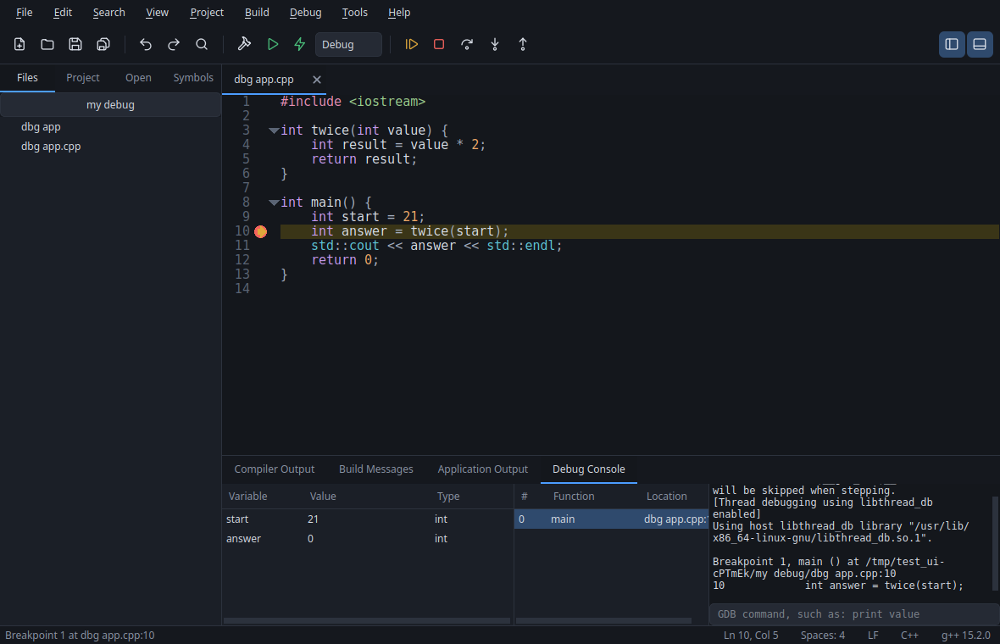
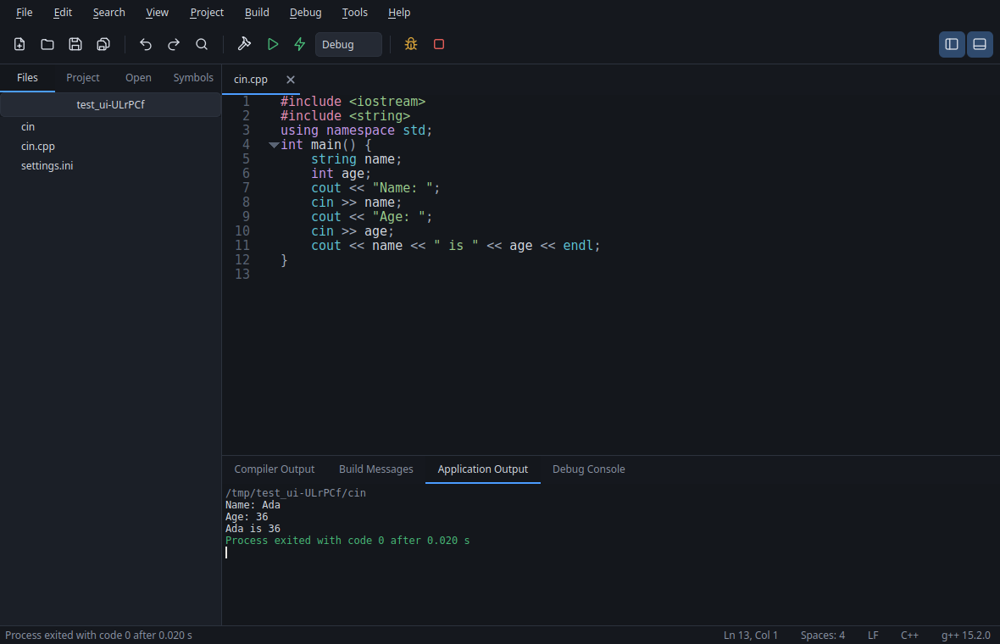
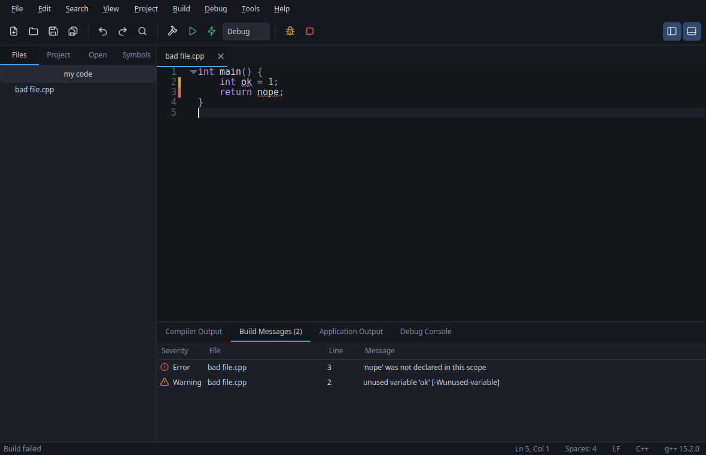
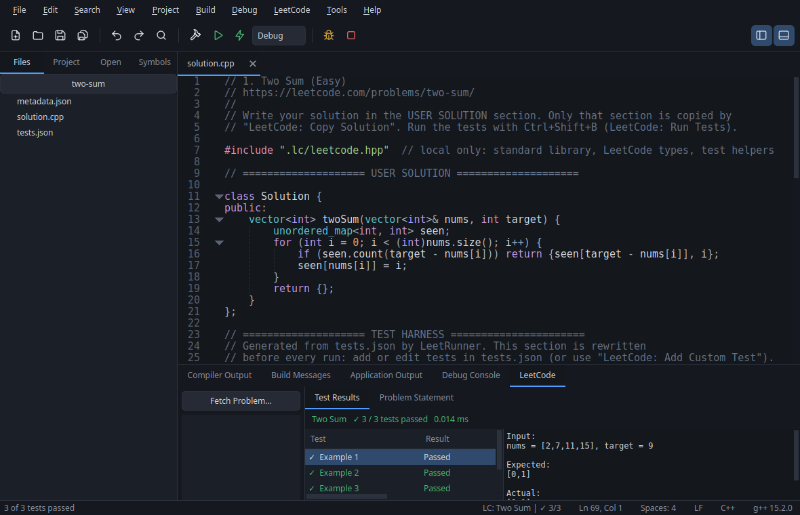

# LightIDE

A lightweight, native C/C++ IDE for Linux, and a modern alternative to Dev-C++.

Open a `.cpp`, press **F11**, and type into your running program. There is no
project to create and no build system to learn. It uses the GCC, G++ and GDB
already on your system, and works entirely offline.



| Interactive program input | Clickable compiler errors |
|---|---|
|  |  |



## Features

- **Editor:** QScintilla with C and C++ highlighting up to C++23, tabs, code
  folding, line numbers, smart indentation, bracket matching and closing, word
  wrap, completion, find and replace, Find in Files, Go to Definition and a
  symbol outline.
- **Compile:** one key to build a single file with no project. Errors and
  warnings are underlined in the editor and clickable in the output, including
  for paths with spaces.
- **Run:** programs run on a real pseudo-terminal, so `printf` prompts appear
  before `scanf` waits, and Ctrl+C and Ctrl+D work as they do in a terminal.
  Stop ends the program and anything it started.
- **Debug:** GDB integration with breakpoints, stepping, variables, call stack
  and a console. Step Into enters your code and steps over the standard library.
- **LeetCode:** fetch a problem by URL, get a ready-to-run C++ file with its
  examples as test cases, run them with one key, and copy a clean solution back
  to submit. Works with folders made by the
  [LeetRunner](https://github.com/ammarqaisar11a55/LeetRunner) VS Code extension.
- **Projects:** optional. Multi-file builds are parallel and incremental, with
  Debug and Release configurations, for executables and static or shared
  libraries, described by a plain JSON file.
- **Yours to adjust:** light and dark themes, editor font and colours, compiler
  flags, language standards and tool paths.

## Installing

### Ubuntu 24.04 and 26.04

Download the `.deb` for your Ubuntu version from the
[releases page](https://github.com/ammarqaisar11a55/Lightweight-C-Cpp-IDE-Modern-Dev-Cpp-Alternative/releases/latest),
then install it, using the name of the file you downloaded:

```bash
sudo apt install ./lightide_0.2.0_ubuntu24.04_amd64.deb
```

You also need the compiler and debugger, if you don't already have them:

```bash
sudo apt install build-essential gdb
```

A `.deb` depends on the Qt version it was built against, so use the one for your
release. On any other release, build from source.

### Building from source

Requires CMake 3.22, Qt 6.4 and QScintilla 2.14 or newer.

```bash
sudo apt install build-essential gdb cmake ninja-build qt6-base-dev qt6-svg-dev libqscintilla2-qt6-dev
```

```bash
cmake -B build -G Ninja -DCMAKE_BUILD_TYPE=Release
```

```bash
cmake --build build
```

```bash
./build/lightide
```

If `qt6-svg-dev` is not available on your release, its package is named
`libqt6svg6-dev`. To make a package for your own system, run
`cmake --build build --target package` from the same build tree.

## Using LightIDE

### A single file

1. Press **Ctrl+N**, or open a `.c` or `.cpp` file.
2. Press **F11** to compile and run.
3. Click into **Application Output** if your program reads input, and type.

To pass command-line arguments, or set the working directory or executable name,
use **Build > Run Options**. These are remembered per file. The executable is
written next to the source unless you choose a default output directory in
**Tools > Settings > Compiler**.

### Debugging

Click in the gutter or press **F8** to set a breakpoint, then press **F5**. With
no breakpoints set, the debugger stops at the start of `main`. Debugging always
builds with symbols, even if Release is selected.

### Projects

**Project > New Project** creates a folder, a `main` source and a `.lideproj`
file. A project file is plain JSON that you can read and edit by hand:

```json
{
    "name": "demo",
    "target": "demo",
    "targetType": "executable",
    "sources": ["src/main.cpp", "src/math_utils.cpp"],
    "headers": ["include/math_utils.h"],
    "compiler": {
        "cxxStandard": "c++20",
        "includeDirs": ["include"]
    }
}
```

Build output goes to `build/debug` or `build/release` inside the project folder.
A file that is not part of the open project still builds on its own.

### LeetCode

1. Press **Ctrl+Alt+F** and paste a problem URL, slug or title. Problems go in
   `~/leetcode`, which you can change under **Tools > Settings > LeetCode**.
2. Write your code in the `USER SOLUTION` section of `solution.cpp`.
3. Press **Ctrl+Shift+B** to run every example. Results, expected and actual
   output, and each test's own prints appear in the **LeetCode** tab.
4. Press **Ctrl+Alt+C** to copy just your solution, then paste it into LeetCode
   and submit. LightIDE never submits or judges for you.

Everything after the `TEST HARNESS` marker is regenerated from `tests.json`
before each run, so your section is never rewritten. Each test runs in its own
process with a time limit, so a crash or infinite loop stays in that one test.

Also under the **LeetCode** menu:

- **Run Current Test** (**Ctrl+Alt+R**) runs the test at the cursor.
- **Debug Solution** stops at your breakpoints in GDB.
- **Add Custom Test** checks your input against the C++ types.
- **Refresh Problem** updates the statement and examples, and keeps your code
  and custom tests.

To keep debug prints out of what you submit, wrap them in `#ifdef LC_LOCAL` or
end the line with `// @local`.

Public problems need no account. For Premium problems, **Connect Account** takes
the `LEETCODE_SESSION` cookie from your browser. It stays in memory until you
close LightIDE, so you enter it each session, and it is never written to disk.

Set `"comparison"` in a problem's `metadata.json` to `exact`, `unordered` or
`unordered-deep` if it accepts answers in any order. The test results suggest
this when an answer differs only in order.

Interactive, SQL, shell and concurrency problems aren't supported. Problems with
special judges, such as linked list cycles, get a harness that you wire up once.

### Keyboard shortcuts

| Action | Shortcut | | Action | Shortcut |
|---|---|---|---|---|
| New File | Ctrl+N | | Compile | F9 |
| Open File | Ctrl+O | | Run | F10 |
| Save | Ctrl+S | | Compile & Run | F11 |
| Save All | Ctrl+Shift+S | | Build | Ctrl+F9 |
| Close Tab | Ctrl+W | | Debug / Continue | F5 |
| Find | Ctrl+F | | Stop | Shift+F5 |
| Replace | Ctrl+H | | Step Over | F6 |
| Find in Files | Ctrl+Shift+F | | Step Into | F7 |
| Go to Line | Ctrl+G | | Step Out | Shift+F7 |
| Go to Definition | F12 | | Toggle Breakpoint | F8 |
| Toggle Sidebar | Ctrl+B | | Toggle Bottom Panel | Ctrl+J |
| Fetch Problem | Ctrl+Alt+F | | Run LeetCode Tests | Ctrl+Shift+B |
| Copy Solution | Ctrl+Alt+C | | Run Current Test | Ctrl+Alt+R |

In Application Output, Ctrl+C interrupts the program unless text is selected,
in which case it copies. Ctrl+Shift+C always copies.

## Troubleshooting

**"G++ Not Found" or "GDB Not Found".** Install the tools with
`sudo apt install build-essential gdb`, or if they are installed elsewhere, set
their paths under **Tools > Settings > Compiler**. **Tools > Compiler Status**
shows what LightIDE found.

**A full-screen terminal program looks wrong.** Application Output is a
line-oriented view, not a full terminal emulator. Programs using `ncurses` should
be run from a real terminal.

## Development

The tests run the real compiler, debugger and processes, and need no display:

```bash
cmake -B build -G Ninja -DCMAKE_BUILD_TYPE=Debug
```

```bash
cmake --build build
```

```bash
ctest --test-dir build --output-on-failure
```

[docs/ARCHITECTURE.md](docs/ARCHITECTURE.md) explains how the code is organized
and why.
